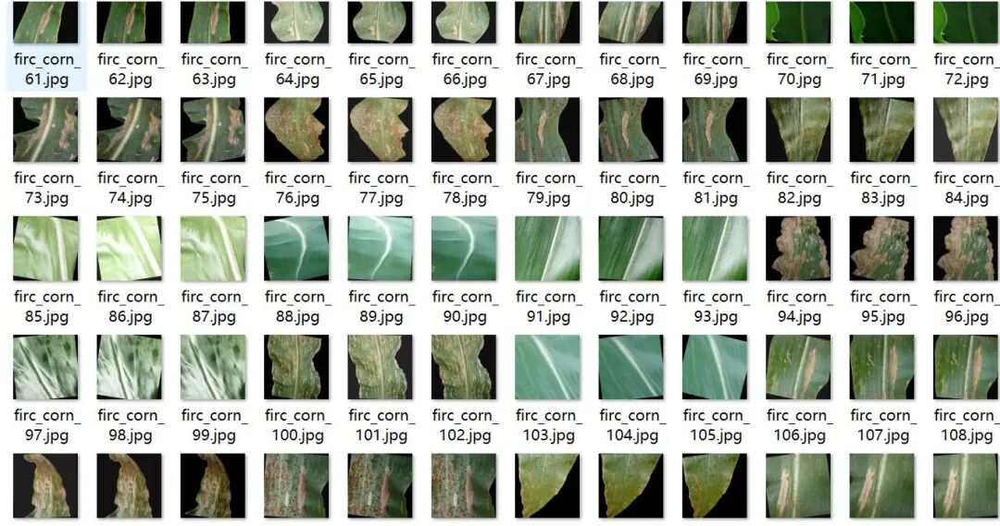
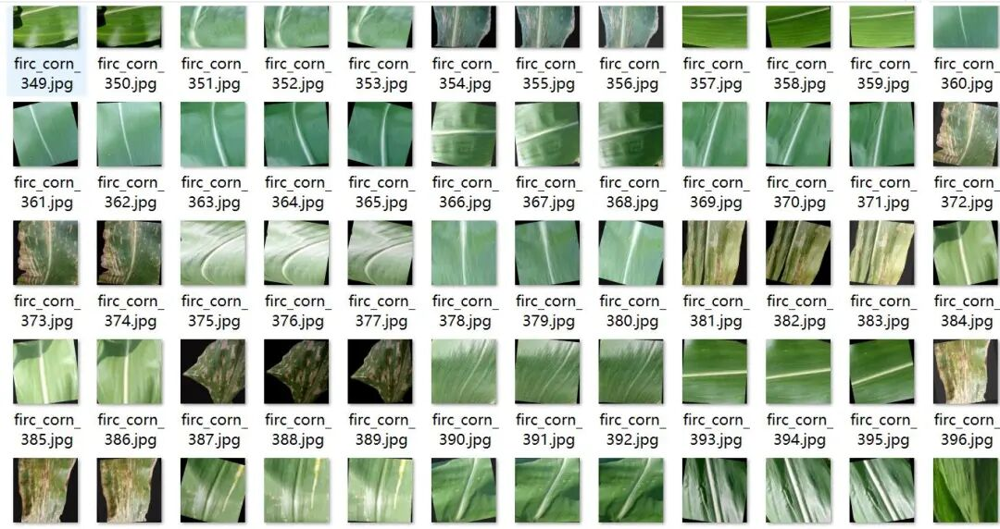
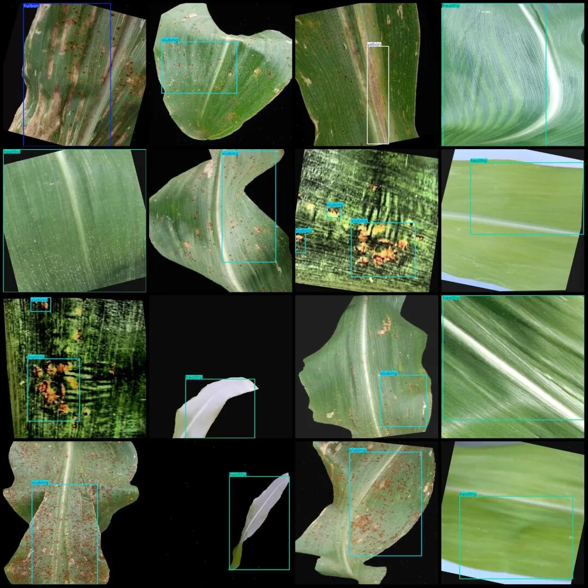
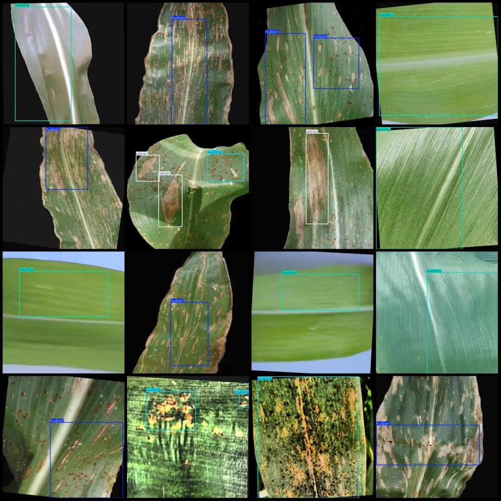

# Dataset of Corn Leaf Disease Detection in VOC+YOLO format with 4 categories, 4154 images.

Please note that approximately one-third of the dataset consists of original images, with the remaining being enhanced images primarily for rotation.

Dataset format: Pascal VOC format + YOLO format (txt file without split path, only containing jpg images and corresponding VOC format xml files and yolo format txt files)

Number of images (number of jpg files): 4154

Number of annotations (number of xml files): 4154

Number of annotations (number of txt files): 4154

Labeling category count: 4

Label category names (Note that the order of yolo format categories does not correspond to this, but is based on the classes.txt in the labels folder): ["healthy", "huiban", "xiubing", "yeban"]

Number of boxes labeled in each category:

Healthy (health) frame count = 1589

Huiban (Grey Spot) Frame Count = 1246

Xiubing (rust) frame count = 1499

yeban (yellow spot) frame count = 986

Total frames: 5320

Image resolution: 640x640

Using labelImg:

Annotation rules: Draw a rectangle around the category.

Important Notice: No

Special : This dataset does not guarantee the accuracy of the trained models or weight files.

Image Preview:

Annotation example:

## Payment

Here is a pay link on Stripe ( https://buy.stripe.com/3cs8yP7sY87d0vu9AB ). Please contact me lonlonago@foxmail.com after funding $89, and I will send you a complete data files , thank you!

